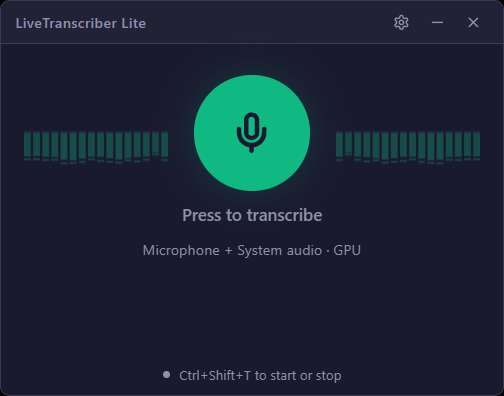
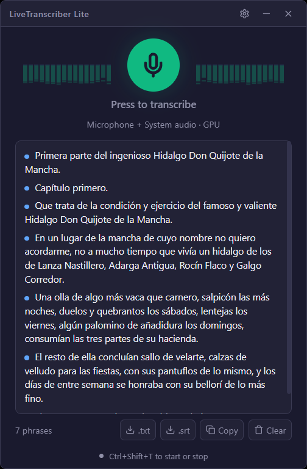

# LiveTranscriber Lite

Transcribe en vivo una reunión en **español o inglés** a partir del micrófono y del audio del
sistema (lo que suena por los altavoces o los cascos), en local y sin conexión, y la guarda
en `.txt` o `.srt`. Hay versión para Windows y para macOS con Apple Silicon (esta, en pruebas).

Es la versión recortada de [LiveTranscriber](https://github.com/alexwing/LiveTranscriber): no traduce, no habla, no
tiene subtítulos ni perfiles. Pulsas el botón, transcribe, y al parar lo guardas.

<p align="center">
  
  &nbsp;
  
</p>

## Modelo

[NVIDIA Parakeet TDT 0.6B v3](https://huggingface.co/istupakov/parakeet-tdt-0.6b-v3-onnx) en
ONNX, cargado con [onnx-asr](https://github.com/istupakov/onnx-asr). La segmentación por frases
la hace el VAD Silero.

- **Detecta solo el idioma.** No hay selector: reconoce español e inglés, y también los demás
  idiomas europeos que cubre el modelo.
- **CPU por defecto (int8, unos 650 MB).** Con 4 hilos en un i7-14700KF, 14,5 s de audio se
  transcriben en 0,5 s (RTF ≈ 0,04). No usa la GPU para nada.
- **GPU opcional en Windows (fp32, unos 2,4 GB de VRAM) con DirectML**, en cualquier tarjeta con
  DirectX 12. En una RTX 3060 el mismo audio tarda 0,1 s. Con las frases cortas de una reunión
  la diferencia frente a la CPU es pequeña: los dos modos van de sobra en tiempo real. Se
  instala desde Ajustes (ver [GPU](#gpu)). En macOS siempre va en la CPU.
- Un solo proceso Python, con una sola copia del modelo, atiende al micrófono y al audio del
  sistema a la vez.

## Instalación desde la release

Todo está en [Releases](https://github.com/alexwing/LiveTranscriberLite/releases).

### Windows 10/11

1. Descarga `LiveTranscriber.Lite_<versión>_x64-setup.exe` (o el `.msi`) e instálalo.
2. Ábrela. La primera vez se prepara sola, con el progreso en la ventana: instala el runtime de
   Microsoft Visual C++ si falta (Windows pide permiso de administrador una vez), Python si no
   lo hay, el entorno y el modelo de voz (~1 GB) en `%LOCALAPPDATA%\LiveTranscriberLite`. Tarda
   unos minutos; después arranca al momento.

También hay un `.zip` portable con el ejecutable y los scripts: descomprímelo y abre
`LiveTranscriberLite.exe`; se prepara igual.

### macOS (Apple Silicon, en pruebas)

Necesita macOS 13 o posterior; el audio del sistema, macOS 14.2 o posterior.

1. Descarga `LiveTranscriberLite_<versión>_aarch64.dmg`, ábrelo y arrastra la app a Aplicaciones.
2. La app no está firmada por Apple, así que la primera vez macOS no la deja abrir: ve a
   Ajustes del Sistema > Privacidad y seguridad y pulsa «Abrir igualmente».
3. Ábrela. Se prepara sola igual que en Windows: si no hay un Python 3.10–3.13 baja uno con
   [uv](https://github.com/astral-sh/uv), sin permisos de administrador, y deja el entorno y el
   modelo en `~/Library/Application Support/LiveTranscriberLite`.
4. La primera vez que transcribe, macOS pide permiso para el micrófono y para grabar el audio
   del sistema.

No hay versión para Mac con Intel.

### GPU

Solo en Windows. En **Ajustes > Procesamiento** elige **GPU**. Si el soporte de GPU no está
instalado, debajo aparece **Instalar soporte de GPU (~3 GB)**: al pulsarlo, la app cambia
`onnxruntime` por `onnxruntime-directml` y baja el modelo fp32, con el progreso en la ventana.
Mientras falte, transcribe en la CPU y la pantalla principal lo avisa.

Lo mismo a mano, desde una consola:

```bash
"%LOCALAPPDATA%\LiveTranscriber Lite\install.cmd" -Gpu
```

## Instalación desde el código

### Windows

Requisitos: Windows 10/11, Python 3.10–3.13, Rust (MSVC) y Node 18+.

```bash
install.cmd
```

Con GPU (instala `onnxruntime-directml` en lugar de `onnxruntime` y baja también el modelo fp32):

```bash
install.cmd -Gpu
```

Otras opciones de `scripts\install.ps1`:

| Opción | Qué hace |
|---|---|
| `-InstallPython` | instala Python con winget si no lo encuentra |
| `-ModelsDir <ruta>` | carpeta de la caché de modelos (se guarda como `hf_home`) |
| `-SkipBuild` | no compila la app |
| `-SkipVerify` | no ejecuta `scripts\verify.ps1` al final |
| `-Force` | rehace el venv |
| `-ResetConfig` | reescribe la configuración (deja una copia de la anterior) |

`scripts\verify.ps1` comprueba el entorno, los modelos y la captura, y hace una prueba de punta a
punta con el sidecar (`scripts\smoke_test.py`).

### macOS

Requisitos: macOS 13 o posterior en Apple Silicon, las herramientas de línea de órdenes de Xcode,
Rust y Node 18+. Python 3.10–3.13 es opcional: con `--install-python` se baja uno con uv.

```bash
bash scripts/install.sh --install-python
```

Tiene las mismas opciones que `install.ps1`, con guiones (`--models-dir`, `--skip-build`,
`--skip-verify`, `--force`, `--reset-config`). No tiene GPU: en macOS el reconocimiento va en la
CPU.

Los modelos se guardan en `~/.cache/huggingface/livetranscriberlite` (en Windows,
`%USERPROFILE%\.cache\huggingface\livetranscriberlite`), o en `<hf_home>/livetranscriberlite` si
`hf_home` está puesto.

## Uso

- **Botón verde:** empieza a transcribir. La primera vez tarda unos segundos en cargar el modelo.
- **Botón rojo:** para. Debajo quedan **.txt**, **.srt**, **Copiar** y **Borrar**.
- **Ctrl+Shift+T** (⌘⇧T en Mac): arranca y para desde cualquier sitio. La ✕ manda la app a la bandeja.
- **Engranaje:** abre los ajustes: micrófono y dispositivo de salida, CPU o GPU (con el botón
  para instalar el soporte de GPU si falta), carpeta y nombre
  del fichero, idioma de la interfaz y, en "Avanzado", hilos, silencio para cerrar frase,
  duración máxima de frase y compensación de volumen.

Los ficheros se guardan en `Documentos\LiveTranscriberLite` como
`AAAA_MM_DD_reunion.txt` / `.srt`, con `_2`, `_3`… si ya existe. Cada línea va marcada con
`[micro]` o `[sistema]`.

## Configuración

`%APPDATA%\LiveTranscriberLite\transcriber-config.toml` en Windows y
`~/Library/Application Support/LiveTranscriberLite/transcriber-config.toml` en macOS, o la ruta
de la variable
`LIVETRANSCRIBERLITE_CONFIG`. La plantilla comentada está en
[transcriber-config.example.toml](transcriber-config.example.toml). La ventana solo guarda los
campos que cambias, así que puedes editar el fichero a mano sin que te lo pise.

## Desarrollo

```bash
npm run app:dev
```

Usa el `transcriber-config.toml` del repositorio. El servidor de Vite escucha en el 5175, para
no chocar con LiveTranscriber (5174).

Sin interfaz:

```bash
cargo run -p asr-cli -- devices
```

```bash
cargo run -p asr-cli -- run --from both
```

```bash
.venv\Scripts\python.exe scripts\smoke_test.py --device cpu
```

Build de release: `npm run app:build`. Si compilas a mano con `cargo build --release`, añade
`--features tauri/custom-protocol`; sin eso la ventana intenta abrir el servidor de Vite.

## Cómo está hecho

```
crates/asr-audio   captura (WASAPI en Windows, Core Audio en macOS) y normalización de volumen
crates/asr-core    configuración, sesiones, sidecar compartido y exportación
crates/asr-cli     herramienta de línea de órdenes (devices, level, run)
src-tauri          app Tauri: comandos, bandeja, atajo global
src                interfaz React
sidecar            asr_server.py: Parakeet + VAD Silero
```

El protocolo entre Rust y el sidecar, los comandos de Tauri y los eventos están en
[docs/lite-contract.md](docs/lite-contract.md).

## Licencia

MIT. Ver [LICENSE](LICENSE).
